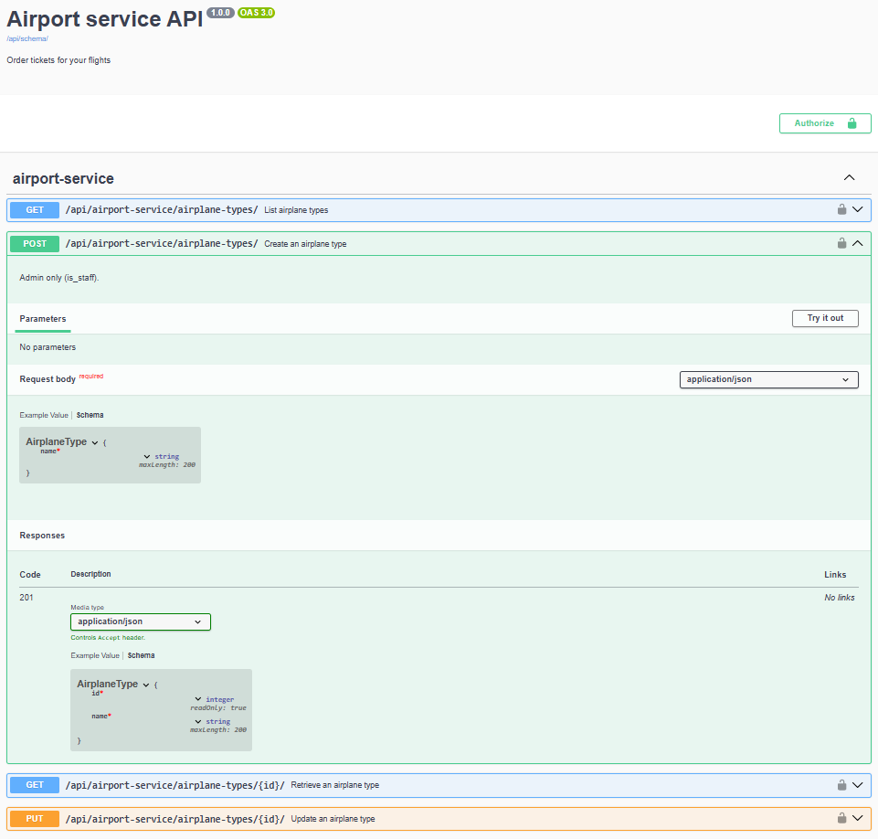
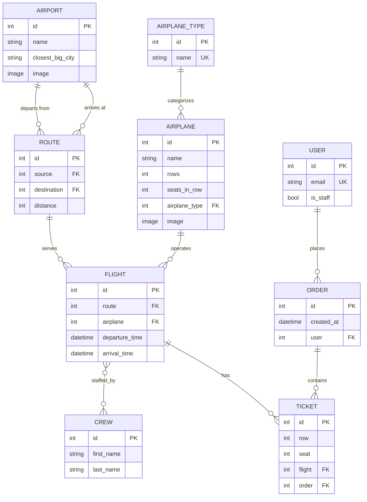

# Airport Service API


## Features

- JWT authentication on a custom user model that logs in by email
- Atomic booking: an order and all of its seats are written in one request,
or nothing is written at all
- Filtering on every list endpoint — by city, date range, capacity, crew and
seat availability
- Free seats per flight calculated in SQL, never counted in Python
- Role-based access: admins manage reference data, passengers book and see
only their own orders
- Image upload for airports and airplanes
- OpenAPI 3 schema with Swagger UI and ReDoc, filters included
- tests covering models, serializers, views and permissions
- Runs in Docker Compose with a health-checked PostgreSQL service

## Tech stack

Python 3.14 · Django 6.0 · Django REST Framework 3.18 · PostgreSQL 15 ·
simplejwt · drf-spectacular · Pillow · Docker Compose

REST API for an airport management system: airports, routes, airplanes, crew,
flights and ticket orders. Django REST Framework, JWT auth, PostgreSQL, Docker.

## API documentation



Interactive docs are generated from the code by drf-spectacular:
`/api/doc/swagger/`, `/api/doc/redoc/`, `/api/schema/`.

## Environment variables

Copy `.env.sample` to `.env` and fill it in:

```
SECRET_KEY=your-secret-key
DEBUG=True

POSTGRES_DB=airport
POSTGRES_USER=airport_user
POSTGRES_PASSWORD=your-password
POSTGRES_HOST=localhost
POSTGRES_PORT=5432
PGDATA=/var/lib/postgresql/data
```

Inside Docker Compose `POSTGRES_HOST` is overridden to `db`. Avoid `$` in
`SECRET_KEY` — Compose interpolates it.

## Run with Docker

```
git clone https://github.com/<your-account>/airport-service-api.git
cd airport-service-api
copy .env.sample .env
docker compose up --build
docker compose exec app python manage.py createsuperuser
```

The API is available at `http://127.0.0.1:8000/`.

## Run locally

```
python -m venv venv
venv\Scripts\activate
pip install -r requirements.txt
python manage.py migrate
python manage.py createsuperuser
python manage.py runserver
```

## Tests

```
python manage.py test
```

Covers computed properties, the upload path builder, seat validation,
serializer switching per action, every filter, the `tickets_available`
annotation, the permission matrix and the JWT flow.

## Endpoints

| Endpoint | Methods |
|---|---|
| `/api/airport-service/airports/` | GET, POST |
| `/api/airport-service/airports/{id}/` | GET, PUT, PATCH |
| `/api/airport-service/airports/{id}/upload-image/` | POST |
| `/api/airport-service/routes/` | GET, POST |
| `/api/airport-service/crew/` | GET, POST |
| `/api/airport-service/airplane-types/` | GET, POST |
| `/api/airport-service/airplanes/` | GET, POST |
| `/api/airport-service/airplanes/{id}/upload-image/` | POST |
| `/api/airport-service/flights/` | GET, POST |
| `/api/airport-service/orders/` | GET, POST |
| `/api/airport-service/tickets/` | GET |
| `/api/user/register/` | POST |
| `/api/user/token/` `token/refresh/` `token/verify/` | POST |
| `/api/user/me/` | GET, PUT, PATCH |
| `/api/doc/swagger/` `/api/doc/redoc/` `/api/schema/` | GET |

Every resource has a detail route at `{id}/`. Reference data supports GET,
PUT and PATCH there; orders and tickets are read-only once created.

The flight list includes `tickets_available` — free seats calculated in SQL.

### Booking

Tickets are not created on their own: an order and all of its tickets are
written in a single atomic request. If any seat is taken or out of range,
nothing is saved — neither the order nor the remaining tickets.

```http
POST /api/airport-service/orders/

{
    "tickets": [
        {"row": 12, "seat": 3, "flight": 14},
        {"row": 12, "seat": 4, "flight": 14}
    ]
}
```

## Filtering

| Resource | Parameters |
|---|---|
| airports | `name`, `city` |
| routes | `source`, `destination`, `from_city`, `to_city`, `min_distance`, `max_distance` |
| crew | `name` (first or last) |
| airplane-types | `name` |
| airplanes | `name`, `airplane_type`, `min_seats`, `max_seats` |
| flights | `routes`, `airplane_type`, `crew`, `date`, `date_from`, `date_to`, `from_city`, `to_city`, `available` |
| orders | `date_from`, `date_to` |
| tickets | `flight`, `order` |

Id parameters accept a comma-separated list. Filters can be combined:

```
GET /api/airport-service/flights/?from_city=kyiv&date_from=2026-11-10&available=true
```

## Authentication

Authentication uses JWT. The access token lives 10 minutes, the refresh token
3 days. Get a token at `POST /api/user/token/` with `email` and `password`, then
send it with every request:

```
Authorization: Bearer <access_token>
```

| Role | Read | Write |
|---|---|---|
| Anonymous | no | no |
| Authenticated | yes | no |
| Staff | yes | yes |

Orders are the exception: any authenticated user can book seats, and every
user sees only their own orders and tickets. Foreign records are invisible
rather than forbidden — a request for someone else's order returns 404.

Pagination: `LimitOffsetPagination`, default limit 5.
Throttling: 100 requests/day anonymous, 1000/day authenticated.

## Database schema



```
Airport ──< Route >── Airport          source / destination
Route ──< Flight >── Airplane >── AirplaneType
Flight >──< Crew                       many-to-many
Flight ──< Ticket >── Order >── User
```

- `Airplane.seats` and `Crew.full_name` are computed properties.
- `Ticket` is unique on `(flight, row, seat)` and validates the row and seat
  against the airplane capacity.
- `User` is a custom model with `email` as `USERNAME_FIELD`.

## Project architecture

```
API/
├── airport/                  # core domain app
│   ├── migrations/
│   ├── tests/
│   │   ├── test_models.py
│   │   ├── test_serializers.py
│   │   ├── test_views.py
│   │   └── test_permissions.py
│   ├── views/                # one module per resource group
│   │   ├── base.py           # query-parameter parsing helpers
│   │   ├── airport.py
│   │   ├── airplane.py
│   │   ├── flight.py
│   │   └── order.py
│   ├── models.py
│   ├── serializers.py        # separate serializers for list / retrieve / write
│   ├── permissions.py        # IsAdminAllOrIsAuthenticatedReadOnly
│   └── urls.py               # DefaultRouter
├── user/                     # custom user model and auth endpoints
│   ├── tests/
│   ├── models.py             # User with email as USERNAME_FIELD
│   ├── serializers.py
│   ├── views.py
│   └── urls.py
├── airport_service/          # project settings and root urlconf
├── Dockerfile
├── docker-compose.yaml
├── requirements.txt
└── manage.py
```

## Notes on the implementation

- Separate serializers per action: lists return related objects as ids, detail
  views expand them.
- `select_related` and `prefetch_related` in `get_queryset` per action — the
  flight list went from 171 queries to a constant number.
- `tickets_available` is annotated with `F()` and `Count(distinct=True)`;
  nothing is counted in Python.
- Seat validation lives in `Ticket.validate_seat()` and is reused by the model
  `clean()` and the serializer `validate()`; the unique constraint is enforced
  by the database and translated into a 400 response.
- Booking runs inside `transaction.atomic()`, so a rejected seat never leaves
  an empty order behind.
- Query parameters go through typed helpers, so `?date=garbage` answers 400
  with a field-level message instead of raising a 500.
- Database-level constraints guard the invariants that matter: arrival after
  departure, a route that does not start and end at the same airport, and a
  positive seat count.
- Images are uploaded through a dedicated `upload-image` action with
  `MultiPartParser`.
- The database service has a `pg_isready` health check, so migrations never
  start before PostgreSQL is ready.
